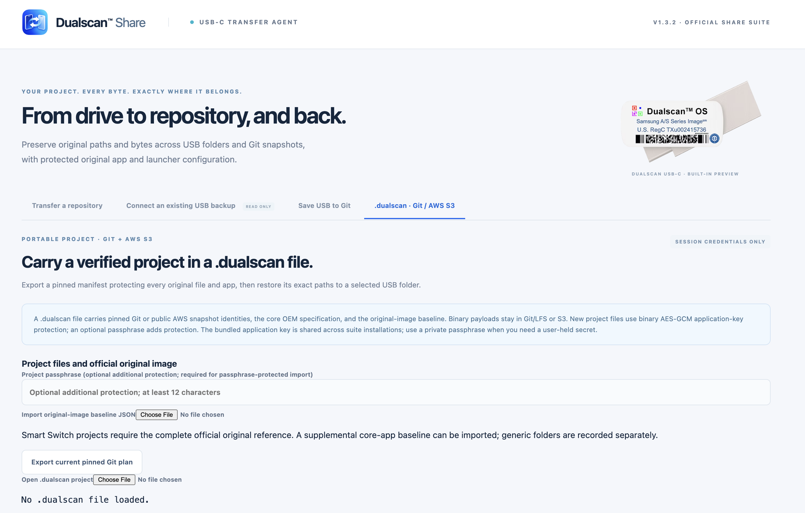
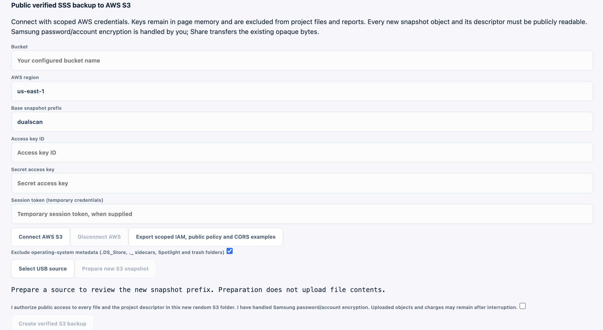

# Dualscan™ Share Instruction Manual

**For Share Suite 1.3.2 · Updated October 27, 2026**

Use Dualscan™ Share on a desktop computer to copy a pinned public GitHub repository to USB, inspect a Samsung Smart Switch package, save a USB dataset to your own Git account or AWS S3 bucket, and create or restore a protected `.dualscan` project file. The macOS app, Windows app and Chrome extension share the same workspace and button names.

[Get Share Suite](https://dualscan.cloud/share/#downloads) · [Online manual](https://dualscan.cloud/share/manual.html) · [Privacy](https://dualscan.cloud/share/privacy.html)

## Contents

1. [Create a .dualscan file](#create-dualscan)
2. [Install or update Share](#installation)
3. [Choose the right workspace](#workspaces)
4. [Make the original Dualscan OS USB](#original-usb)
5. [Restore an existing .dualscan project](#restore-project)
6. [Inspect a USB package and its apps](#inspect-usb)
7. [Prepare a verified derivative](#derivative-rules)
8. [Save USB to Git](#save-git)
9. [Create a public AWS S3 backup](#aws-backup)
10. [Protect project metadata and credentials](#protection)
11. [Pause cancel and recover](#recovery)
12. [Troubleshoot common problems](#troubleshooting)
13. [Understand files reports and verification](#verification)
14. [Get help](#support)

<a id="create-dualscan"></a>

## 1 Create a .dualscan file

A `.dualscan` file is a protected project manifest: it records where the remote files live, their pinned identities and paths, and the applicable original-image protection reference. The backup binaries remain in Git/LFS or AWS S3. Keep that source available for restoration.

### Export from a public GitHub repository

You can create this file before copying anything to USB.

1. Open **Transfer a repository**. Select **Make Original Dualscan OS USB-C** to show the repository form.
2. Keep the default `https://github.com/sacs2cd-web/dualscan-os`, or enter your public GitHub repository root. For a saved snapshot, enter its branch or full commit in **Branch, tag, or commit**.
3. Click **Pin & analyze** and wait for a successful source pin.
4. Open the last tab, **.dualscan · Git / AWS S3**.
5. Under **Project files and official original image**, optionally enter a **Project passphrase**. If used, it must contain 12–1024 characters. Keep it separately so the recipient can open the project.
6. Click **Export current pinned Git plan**. Save the downloaded `.dualscan` file in a location you can find.

**Where is the export button?** In the screenshot below, it is the white button at the lower left, below the original-image baseline text and immediately above **Open .dualscan project → Choose File**. The optional baseline file chooser is a separate control.



*The export button creates a new project from the repository already pinned in the first tab. The Open .dualscan project chooser opens an existing file.*

For Smart Switch projects, export checks the complete official original reference. An available complete reference can be reused; otherwise Share fetches it. This may take additional time and requires an internet connection. The default official repository uses its analyzed commit as the original pin. For an older derivative, select or import the complete baseline matching its original pin; a fresh default reference can include newer files. A derivative that changes or omits original files is blocked.

**Save filename.dualscan** saves another copy of the project currently created or opened in this workspace. It becomes available when a project is loaded. It does not analyze a repository or scan a USB drive by itself.

### Create one after a USB backup

- **USB to GitHub:** complete [Save USB to Git](#save-git), then analyze the resulting repository and snapshot branch in the first tab. Follow the export steps above. Saving to Git does not automatically download a `.dualscan` file.
- **USB to AWS S3:** complete [Create a public AWS S3 backup](#aws-backup). After every object and descriptor passes verification, Share downloads `DUALSCAN-OS-<uuid>.dualscan`. Its ID matches the new S3 dataset folder.

The current portable project restore sources are public GitHub and supported AWS S3 projects. GitLab and Bitbucket Cloud are available as USB-save destinations; their repositories cannot be used directly as Git `.dualscan` restore sources in this release.

<a id="installation"></a>

## 2 Install or update Share

Download the package for your computer from the [Share downloads page](https://dualscan.cloud/share/#downloads) or the [official GitHub release](https://github.com/sacs2cd-web/dualscan-os-share-suite/releases/tag/v1.3.2).

| Computer or environment | Package |
| --- | --- |
| Mac with Apple silicon such as an M-series chip | `Dualscan-Share-1.3.2-mac-arm64.zip` |
| Intel Mac | `Dualscan-Share-1.3.2-mac-x64.zip` |
| Windows x64 | `Dualscan-Share-1.3.2-win-x64.exe` |
| Desktop Chrome 132 or newer | `dualscan-share-1.3.2.zip` |

The Mac packages declare macOS 13.0 as their minimum. Native desktop packages include their browser runtime; you do not need a separate Chrome installation to run them. Use the desktop workflow rather than a phone browser for USB directory access.

### Verify the download

Download [SHA256SUMS.txt](https://github.com/sacs2cd-web/dualscan-os-share-suite/releases/download/v1.3.2/SHA256SUMS.txt) from the same release. Compare the complete SHA-256 for your exact filename.

On macOS, open Terminal and run:

```sh
shasum -a 256 ~/Downloads/Dualscan-Share-1.3.2-mac-arm64.zip
```

For Intel, substitute `Dualscan-Share-1.3.2-mac-x64.zip`. If you saved elsewhere, use that path.

On Windows, open PowerShell and run:

```powershell
Get-FileHash "$env:USERPROFILE\Downloads\Dualscan-Share-1.3.2-win-x64.exe" -Algorithm SHA256
```

A matching checksum verifies the downloaded bytes against the published digest. It does not establish publisher identity or malware safety. A mismatch requires a fresh download and investigation before opening the file.

### macOS

1. Extract the ZIP for your architecture. Move **Dualscan™ Share Suite** to Applications and try opening it.
2. Mac builds use ad-hoc signatures and have no Developer ID signing or Apple notarization. If macOS cannot verify the developer, proceed only after checking and trusting this exact download.
3. If offered, use **System Settings → Privacy & Security → Open Anyway**, then confirm **Open** and authenticate. This creates an exception for this app.
4. If macOS reports malware, damage or an administrative policy block, stop and contact support or your administrator. Keep system protections enabled.

See [Apple’s app-opening guidance](https://support.apple.com/en-us/102445).

### Windows

1. Open the verified portable EXE as your normal user. It does not require an installer or administrator launch.
2. The executable is unsigned. If SmartScreen identifies an unrecognized app, choose **More info → Run anyway** only after verifying and trusting the download.
3. If that option is unavailable, or Smart App Control or organization policy blocks it, contact support or your administrator. Keep those protections enabled.

Native Windows execution remains untested for this release. See [Microsoft’s SmartScreen guidance](https://learn.microsoft.com/en-us/windows/apps/package-and-deploy/smartscreen-reputation).

### Chrome extension

1. Extract the Chrome ZIP into a stable folder that you will keep.
2. Open `chrome://extensions` in desktop Chrome and turn on **Developer mode**.
3. Choose **Load unpacked**, then select the extracted folder containing `manifest.json`.
4. Click the Dualscan™ Share toolbar icon. It opens or focuses the full extension page where transfers run.

Keep that page open during work. Do not select the ZIP itself in Load unpacked. This manual describes the downloadable manual-install package; use the version shown in Share’s upper-right header to identify what you are running. See [Chrome’s extension-loading instructions](https://developer.chrome.com/docs/extensions/get-started/tutorial/hello-world#load-unpacked).

### Update an existing installation

Finish the current operation, or cancel it and retain its checkpoint where available, before updating. Quit the older desktop app before replacing it; opening another copy can focus an already-running older version. Reopen the replacement and confirm **V1.3.2** in the header. Session tokens and AWS credentials must be entered again.

For an unpacked Chrome extension, complete or stop its work first. To retain the same extension instance, replace its files in the existing stable folder and reload it through Chrome’s extension manager. Loading a different folder can create a separate instance without the old checkpoint. Do not update a loaded extension during a transfer.

<a id="workspaces"></a>

## 3 Choose the right workspace

| Tab | Use it for |
| --- | --- |
| **Transfer a repository** | Make the official USB image, pin a public GitHub source, or open a prepared `.dualscan` project and restore it through cards 01–03. |
| **Connect an existing USB backup** | Read-only discovery of package roots, Smart Switch snapshots, standalone APK builds and encrypted payload presence. |
| **Save USB to Git** | Save a selected USB folder to a new branch in your GitHub, GitLab.com or Bitbucket Cloud repository. |
| **.dualscan · Git / AWS S3** | Create/export project files, prepare and publish verified public S3 backups, or use the separate project restore controls. |

Card 01’s **Upload .dualscan USB-C image** opens an existing prepared project. To create a file, use **Export current pinned Git plan** in the last tab, or complete a verified S3 backup.

The upper-right USB illustration uses a verified source `assets/dualscan-usb-c.png` when available after source resolution. Otherwise the built-in illustration remains. Selecting or preparing a source alone does not certify its payloads. Preview artwork does not authorize changing protected original files in an SSS derivative.

<a id="original-usb"></a>

## 4 Make the original Dualscan OS USB

1. Connect the intended USB drive. Use your operating system to confirm its identity, available capacity and that it is writable.
2. Open **Transfer a repository → Make Original Dualscan OS USB-C**.
3. Keep the official repository URL. Leave the ref blank for its current default branch, or enter a specific branch, tag or full commit. Click **Pin & analyze**.
4. Review the pinned identity, tracked-file count, transfer size, integrity manifest and any LFS objects. A commit pin fixes the source version for this operation.
5. In card 02, click **Select your USB-C drive** and select the drive’s intended **root folder** in the system picker.
6. Click **Check destination**. This reads paths and hashes existing files without writing. Wait for **Destination check passed**.
7. Confirm both checkboxes: you selected the intended root and checked its free space; you authorize creating the exact missing paths while retaining existing files.
8. Click **Start verified transfer** in card 03. Keep the app/tab open, computer awake and drive connected through verification.
9. Wait for verified completion. Export the evidence report if needed, then use your operating system’s safe-eject function.

The picker cannot certify that a folder is a USB-C device root, identify the connector or measure the drive’s free capacity. Those checks are yours to make in the operating system. A USB-C connector alone does not establish transfer speed.

### Root placement and existing files

The source’s relative paths are restored directly under the chosen destination. Share does not add a repository-name folder or repository ZIP wrapper, and it does not format the drive.

```text
Selected USB root/
├── SmartSwitchBackup2/
│   ├── official-device/
│   │   └── original-snapshot/...
│   └── added-device/
│       └── added-snapshot/...
├── USTFD USPS CRADA APPS Oct 2026/
└── other original repository files
```

Device names and snapshot names above are examples. Share discovers actual names instead of hardcoding them.

An identical existing file is hashed and can be reused. Different, unreadable or conflicting paths block writes. Choose another destination or resolve the conflict outside Share, then check again. Extra unrelated destination files are not deleted; choose an appropriate clean destination when you need the USB to contain only this project.

**Samsung Smart Switch ready** is shown only for an eligible Smart Switch transfer after complete verification. It does not certify that a particular Galaxy device will accept or successfully restore the backup. Share does not perform the Samsung restore itself.

<a id="restore-project"></a>

## 5 Restore an existing .dualscan project

Use the main **Transfer a repository** workspace for the complete USB restore flow, including its pause and checkpoint controls.

1. Obtain the `.dualscan` file and, if set, its passphrase from the project owner. Confirm that the referenced Git/S3 dataset will remain available.
2. Select **Upload .dualscan USB-C image** in card 01.
3. If the file is passphrase-protected, enter **Project passphrase** before clicking **Choose .dualscan file**. Select the file.
4. Allow source checks to finish. GitHub projects resolve their pinned commit. For a public S3 project, click **Enable public AWS source** and approve the exact regional host when prompted. Public S3 downloads need no AWS keys. Supported legacy private SSS projects require credentials for the named bucket/region and a complete pinned official original reference. Generic legacy S3 manifests can open but cannot authorize a restore.
5. If a source check was interrupted or credentials changed, use **Recheck project source** to retry. If the file has not decoded successfully, enter the required passphrase and use **Open selected project** instead. The official original reference and snapshot markers must pass before an SSS restore can proceed.
6. Select the USB root in card 02, run **Check destination**, review any reused files and collisions, confirm both authorizations and click **Start verified transfer**.
7. Wait for final read-back verification, export evidence if wanted and safely eject the drive.

A project contains remote source information rather than all backup binaries. An offline, removed, private or inaccessible source can prevent restoration even when the project file opens successfully.

For verified nested packages, Share removes the validated outer package wrapper. `SmartSwitchBackup2`, OEM installers and the other original package files land at USB root. The S3 random folder ID and its cloud storage prefix do not become extra USB wrapper folders.

### Opening a file through the operating system

In-app **Choose .dualscan file** is the dependable import route. Windows portable builds do not install a default `.dualscan` association. Use in-app import, or configure **Open with** yourself if appropriate.

If a desktop-opened project waits for a passphrase, enter it in the project workspace and use **Open received desktop project** to retry. Imports are limited to 32 MiB. There is no passphrase-reset service.

### Separate restore controls in the last tab

The last tab also contains **Open .dualscan project**, **Select USB restore destination**, **Check project and destination** and **Restore missing files and verify**. Review its creation-consent checkbox before starting. This workspace offers **Cancel current project operation**, rather than the main transfer’s pause/durable-checkpoint workflow. Use the main card 01 route above for the public AWS enable control and the complete recovery workflow.

<a id="inspect-usb"></a>

## 6 Inspect a USB package and its apps

1. Open **Connect an existing USB backup** and click **Connect USB folder**.
2. Choose the drive root or a containing folder. The scan is read-only and can find nested package folders. It excludes `Source Backup`.
3. Select a **Package root**, then choose a **Smart Switch snapshot** to inspect its encrypted backup payloads. Each snapshot stays separate.
4. Review coverage, marker results, app rows and any unreadable-path warnings. Use **Copy path**, **Copy ID** or **Export discovery report** as needed.

A structurally checked snapshot requires both:

```text
SmartSwitchBackup2/<device>/<snapshot>/SmartSwitchBackupInf.bk
SmartSwitchBackup2/<device>/<snapshot>/APKFILE/AppList.bk
```

These markers establish the checked structure. They do not establish that every backup item is complete or that Samsung will restore it.

### Read the two app statuses independently

| Column or status | Meaning |
| --- | --- |
| **Smart Switch payload** | Presence of the selected snapshot’s encrypted `.enc` restore payload. **Present in Smart Switch — version unverified** does not state its internal app version. |
| **Loose installer** | A standalone `.apk`, identified using its Android package metadata and compared with expected release identities when available. Renamed APKs can still be identified. |
| **Detected installer build** | `versionName` and `versionCode` read from that APK’s `AndroidManifest.xml`. These values do not describe an encrypted backup payload. |
| **Select drive / Choose package / Choose snapshot** | The relevant location has not yet been selected. This is not an absence result. |
| **Not present** | The item was not found within the successfully scanned selected scope. Read this alongside scan coverage and warnings. |
| **Verified current release** | Detected package/build, size and SHA-256 match the commit-pinned expected release. This does not authenticate the APK publisher’s signing certificate. |
| **Older build / Newer build — release differs / Build mismatch** | The detected build differs from release expectations. Review the actual package/build rather than changing the filename to match. |
| **Checksum mismatch / Size mismatch** | File bytes or size differ from the expected release. Keep it out of a verified current-release workflow until resolved. |
| **Permission error / Read error / Scan failed / Scan incomplete** | Inspection was blocked or incomplete. Correct the issue and rescan before drawing an absence conclusion. |
| **Release expectations unavailable** | APK metadata may be readable, but the expected-release manifest could not be obtained or validated. A current-release checksum match has not been established. |

For Diamond Player, the package ID is `com.dualscan.mp`. Its encrypted payload is found independently at `SmartSwitchBackup2/<device>/<snapshot>/APKFILE/com.dualscan.mp.enc`. A loose installer’s detected build never establishes that payload’s internal version.

Current release expectations come from the pinned [OEM APK release manifest](https://github.com/sacs2cd-web/dualscan-os/blob/main/manifests/oem-apk-release.json), rather than a permanently hardcoded installer filename. Use loose `.apk` files for a separate Android installation workflow. Share neither installs them nor decrypts `.enc` files.

If coverage says **PARTIAL SCAN · READ ONLY**, inspect warnings and select a narrower containing folder before rescanning.

<a id="derivative-rules"></a>

## 7 Prepare a verified derivative

Share’s verified Dualscan SSS derivative workflow requires **every original tracked file and app from its pinned official reference to remain present with its exact content identity**. A core-app-only list or unchecked local JSON file cannot authorize a derivative. Read the [Dualscan OS license](https://github.com/sacs2cd-web/dualscan-os/blob/main/LICENSE) alongside these software requirements.

Keep a pristine official package available when choosing an original-image baseline. Match its reference to the official commit from which that USB was created. For an older image, pin that official commit in the first tab before **Choose original image**, or import a previously exported complete baseline for that pin. Updates to the default branch can change the expected file set. Add your own Smart Switch snapshots in separate valid folders below `SmartSwitchBackup2`. Each addition requires its own `SmartSwitchBackupInf.bk` and `APKFILE/AppList.bk`.

- Retain all original files, apps, paths, backup-manifest bytes and original snapshot contents.
- Put additions in separate `<device>/<snapshot>` folders. Adding files inside an original snapshot is blocked.
- Keep `Source Backup` out of the derivative additions.
- Review operating-system metadata exclusions. They do not authorize removing tracked official original files.
- Use **Choose original image** or import a compatible complete baseline when the Git-save workflow requests it. The original is revalidated against the official pinned source.

Original snapshots are logically listed first. Operating systems control physical directory sorting. Share preserves the original `HOMESCREEN/HOMESCREEN.zip` configuration bytes, including opaque launcher data; it does not decode or independently certify phone icon coordinates or home-tray ordering.

Select a single complete package or an unambiguous containing folder without unrelated outside files, apart from approved operating-system metadata exclusions. Verified Git/AWS publication removes only a validated outer package folder. Its restored structure keeps `SmartSwitchBackup2` and all other original package files at USB root.

Ordinary non-SSS folders can be saved to Git as generic snapshots. They do not acquire verified Dualscan derivative or Samsung readiness status. New AWS backups require a verified complete SSS dataset.

<a id="save-git"></a>

## 8 Save USB to Git

This workspace reads a selected USB folder and publishes a new remote snapshot branch. It does not write to the source USB.

1. Open **Save USB to Git**. Under **Git service**, select GitHub, GitLab or Bitbucket Cloud.
2. Sign in on the provider’s own website if needed. Create a token with the access displayed under the selector, limited to your intended repository. Paste it into this workspace’s **Access token** field and click **Connect account**. Complete the optional Git username field when your Bitbucket credential type requires it.
3. Click **Add a USB folder**, then select it under **Snapshot source**. Add other drives separately; the app cannot automatically enumerate every connected USB drive.
4. For a recognized Dualscan SSS dataset, use **Choose original image** and select the pristine official package, or **Import baseline** containing its complete official reference. Wait for full verification. **Export baseline** saves that reference for reuse; it is a JSON file, not your `.dualscan` project.
5. Confirm derivative mode when applicable and review any operating-system metadata exclusion. A recognized SSS dataset cannot bypass original protection by changing the checkbox.
6. Enter **Destination repository URL**, an absent **New snapshot branch** and a commit message. The destination repository must already exist. A reviewed initialization step may be required if it has no commits.
7. If LFS metadata is needed, select **Allow required Git LFS metadata to be added or updated in the repository snapshot** so Share can prepare the proposed changes. Inspect those changes in the next review before authorizing publication. The source USB is unchanged.
8. Click **Prepare & review**. Approve the exact required upload hosts if prompted through **Allow required upload hosts**. Review provider, repository, new branch, byte/file totals, root placement, original protection and generated metadata.
9. Check the upload authorization and click **Save selected USB to Git**. Keep the source and app stable during upload.
10. Read the completion status and use **Export save report**. Interrupted publication may leave new objects or an incomplete new branch; the report identifies partial state.

Signing in to the provider’s website does not connect its API account to Share. This release uses the token field and **Connect account**, rather than a configured one-click OAuth flow. The first tab’s GitHub token is a separate session field.

Existing branches are not force-pushed. Verified SSS packages preserve root-relative original paths and separate added snapshots. Generic snapshots preserve their selected relative paths. Git cannot represent empty directories; consult the report for recorded empty-directory paths.

For LFS files, the Git-save result reports server object identity confirmation. This flow does not independently redownload every uploaded LFS binary. Keep the report’s stated verification scope with the snapshot.

To make a portable project after a **GitHub** save, return to the first tab, pin the output repository and its new branch or full commit, then use [Export current pinned Git plan](#create-dualscan). GitLab and Bitbucket Cloud uploads are not direct project restore sources in this release.

<a id="aws-backup"></a>

## 9 Create a public AWS S3 backup

This workflow publishes an entire verified Dualscan SSS dataset in a new folder in your own bucket. **Every uploaded file and its project descriptor must be publicly readable.** Protect personal Smart Switch additions with Samsung password or Samsung Account encryption before using this workflow. Share transfers their existing opaque bytes and cannot certify that Samsung encryption was applied.

### Connect and prepare

1. Use an existing bucket and its actual AWS region. Arrange scoped upload/read permissions and the appropriate CORS configuration for browser access.
2. Open **.dualscan · Git / AWS S3**. In **Public verified SSS backup to AWS S3**, enter **Bucket**, **AWS region**, **Base snapshot prefix**, **Access key ID**, **Secret access key** and the temporary **Session token** when your credentials include one.
3. Click **Connect AWS S3** and approve the exact regional host if requested. Credentials remain in the open session.
4. Optionally import a complete original-image baseline above the AWS form, especially for an older official pin. Without one, preparation fetches the current official reference.
5. Click **Select USB source** and choose the complete package. A containing folder must hold one unambiguous complete package with no unrelated files outside it, apart from approved operating-system metadata exclusions. If selection is ambiguous, choose the package folder itself. Review **Exclude operating-system metadata** as appropriate, then click **Prepare new S3 snapshot**.
6. Read the proposed random folder, project ID, file/byte totals, original protection and source-package-to-root mapping. Preparation does not upload file contents.



*Enter your own bucket details in the app. The screenshot contains empty example credential fields. Do not put credentials in a project file, report or support message.*

### Configure the exact public folder and publish

7. **After preparation**, click **Export scoped IAM, public policy and CORS examples**. Earlier examples contain a placeholder instead of this new random ID.
8. Review and apply the examples in your AWS account for the intended bucket and **exact prepared prefix**. Public access requires anonymous `GetObject` and prefix-scoped `ListBucket`. Use the actual extension origin in browser CORS instead of `chrome-extension://YOUR_EXTENSION_ID`.
9. Make sure your account and bucket settings permit the intended access. Share does not modify bucket policies, ACLs or Block Public Access. If an administrator must configure these settings, provide the scoped examples for review. Do not expose unrelated bucket prefixes.
10. Check the explicit public-access and Samsung-encryption authorization, then click **Create verified S3 backup**.
11. Wait until every remote file and the descriptor pass anonymous full SHA-256/size read-back. Only then save the downloaded **`DUALSCAN-OS-<uuid>.dualscan`** file. The ID matches its new S3 folder.

**Preparing again creates a new reviewed folder.** Export and apply the policy for that new exact prefix rather than reusing a policy for an earlier preparation.

Access-denied errors or unsuccessful anonymous read-back prevent a completion claim. Uploading and subsequent verification can incur AWS storage, request and data-transfer charges. Completed objects are not rolled back. Share attempts to abort unfinished multipart uploads, but cleanup can fail; inspect the evidence report and bucket after cancellation or failure.

The random cloud folder organizes storage. During a verified restore, its paths map back to the selected USB root, with `SmartSwitchBackup2` directly beneath that root. To restore, use [Upload .dualscan USB-C image](#restore-project) and **Enable public AWS source**; public downloads require no AWS keys.

For account configuration, consult AWS’s [S3 permissions](https://docs.aws.amazon.com/AmazonS3/latest/userguide/using-with-s3-policy-actions.html), [CORS](https://docs.aws.amazon.com/AmazonS3/latest/userguide/enabling-cors-examples.html) and [Block Public Access](https://docs.aws.amazon.com/AmazonS3/latest/userguide/access-control-block-public-access.html) documentation.

<a id="protection"></a>

## 10 Protect project metadata and credentials

New `.dualscan` files use binary Typelocker application protection with authenticated AES-256-GCM. Opening one in TextEdit does not display a plain-text manifest. The shared app key is included in the software and can be recovered by someone with the app. Use the optional private passphrase for confidential project metadata and share it separately with the intended recipient.

A project passphrase protects the project file; it does not encrypt the remote backup binaries or make public S3 object names and files private. Samsung encryption of personal restore payloads is a separate user-managed step.

| Information | Handling |
| --- | --- |
| GitHub token in the first tab | Used for that source’s GitHub API requests. It is not sent to raw/media download hosts. Separate official-reference and OEM-release checks may still use anonymous requests. |
| Provider token in Save USB to Git | A separate account session for the selected provider. Use the access shown in that workspace. |
| AWS access key secret and temporary token | Entered in the AWS session fields; excluded from exported project files and reports. |
| Project passphrase | If set, needed again to open a passphrase-protected export. Keep a separate copy; there is no recovery service. |
| Local transfer checkpoint | Can retain decoded project metadata and a selected directory handle in the app/profile. It excludes tokens/passphrases. Export-file encryption does not imply encrypted local checkpoint storage. |

Closing or reloading the app/page clears session credentials. Use **Sign out** in the Git-save workspace or **Disconnect AWS** to clear those sessions. Protect your operating-system account and app/browser profile. The public backup workflow contains no publisher-operated transfer relay.

<a id="recovery"></a>

## 11 Pause cancel and recover

### Main transfer workspace

- **Pause** changes to **Resume**. Pausing takes effect at a safe processing boundary. Keep the app/tab open and drive connected. A long interruption or network timeout can require the active file to restart.
- **Cancel** stops work; it does not roll back completed new files. Verified files remain, and an interrupted new file can remain empty.
- **Saved transfer available → Restore checkpoint** reloads the main transfer’s current local checkpoint. Grant directory permission again if requested, reconnect the source as needed, check the destination and authorize writes again. Existing files are rehashed instead of trusting a saved completion flag. An interrupted file can restart from byte zero.
- **Forget** removes the local checkpoint and leaves drive files unchanged. Preserve it until recovery is no longer needed; a remaining interrupted file may otherwise need attention outside the app.

Checkpoints belong to the current desktop profile or Chrome profile/extension instance. They do not automatically move between platforms, browser profiles or computers, or travel with the portable EXE. The store holds one current transfer record; a record can remain after completion.

### Git AWS and the separate project workspace

These operations expose cancellation, without the main transfer’s durable resume workflow. Automatic cross-session multipart resume is not implemented. After interruption, inspect the report and remote state before preparing a fresh snapshot. Do not assume that closing the app pauses an upload.

Keep the computer awake during all operations and use the operating system’s safe-eject function only after work has stopped.

<a id="troubleshooting"></a>

## 12 Troubleshoot common problems

| What you see | What to do |
| --- | --- |
| Cannot find **Export current pinned Git plan** | Open the last tab. In **Project files and official original image**, look below the baseline text and above **Open .dualscan project**. See the [screenshot](#create-dualscan). |
| Export says to analyze a repository | Return to the first tab and complete **Pin & analyze** in this same open session. Export uses that current plan. |
| A save button is disabled | Complete its prerequisites: source selection, source/target check and the corresponding authorization. Read the status message near the relevant workspace. |
| GitHub 403 | Read the failed host, token-sent state, reason and quota/reset details when shown. A 403 alone does not establish a rate limit. Ensure the current app is v1.3.2; it fixes the desktop missing-User-Agent failure. |
| GitHub remaining count is zero | Wait until the reported reset time rather than repeatedly clicking retry. A reset ending in `Z` is UTC. |
| Secondary rate limit | Respect GitHub’s `Retry-After`. If no usable value is supplied, wait at least one minute and increase the delay if it recurs. |
| GitHub 401 or token rejected | Check token validity and access for the intended repository. Re-enter it in the correct workspace. Website sign-in alone does not authenticate Share. |
| GitHub 404 | Check the repository root, ref and source availability. Download/project sources support public GitHub; private sources or unavailable objects can fail. |
| OEM release expectations unavailable | Review the discovery warning and retry after its connection or rate restriction clears. The first tab’s token is not supplied to every separate release/reference check. |
| Directory permission denied or read-only drive | Reselect the intended folder, allow the requested access and check the drive’s writable status in the operating system. A folder grant and a network-host grant are separate. |
| Upload host permission requested | Approve only the hosts shown in the reviewed operation. Desktop dialogs use **Allow reviewed transfer hosts** and **Allow hosts**; desktop grants expire when the app exits. |
| Destination collisions | Choose another root or resolve conflicts outside Share. Re-run **Check destination**. Share does not automatically replace different existing files. |
| Original image protection fails | Retain every original file and check the selected official pin/package. Use a complete baseline; restore changed originals from that pin. Keep new snapshots separate and verify both markers. |
| Partial discovery scan | Read warnings and choose a narrower folder. Incomplete coverage cannot support a complete absence conclusion. |
| Wrong passphrase or damaged project | Re-enter the correct passphrase before choosing/retrying the file. If it still fails, obtain a fresh original copy. Renaming a damaged file does not repair it. |
| Project opens but restore cannot connect | Confirm that its pinned Git commit or S3 dataset remains reachable and that required host permissions or legacy bucket credentials are available. |
| S3 anonymous verification fails | Check the exact prepared public prefix, anonymous GetObject/ListBucket access, region and applicable public-access settings. Do not treat an uploaded object count as verified completion. |
| Progress appears slow | Read the active phase/file, verified counts and byte totals. Network latency, many small files, directory operations, hashing and full read-back all add work. Use a suitable drive and port; keep the system awake. A speed rating alone does not predict this workload. |

GitHub’s usual public REST allowance is **60 requests per hour per originating IP** without a token and **5,000 per hour per personal-token account** with authentication. Other resource limits and secondary limits also exist. Use the failing response’s actual values when available. See [GitHub’s rate-limit guidance](https://docs.github.com/en/rest/using-the-rest-api/rate-limits-for-the-rest-api).

<a id="verification"></a>

## 13 Understand files reports and verification

| File or result | Purpose |
| --- | --- |
| `.dualscan` | Protected portable manifest linking a remote dataset to its paths and identities. It contains no full binary backup and exports no account credentials. |
| Original-image baseline JSON | Reusable original-reference/core/launcher protection metadata. Import it only where a baseline is requested. It is not a `.dualscan` restore project. |
| Evidence discovery or save report | A separate record of the selected operation, observed paths, identities, warnings and verification scope. Reports are not backup payloads. |
| `.enc` | An encrypted Samsung Smart Switch restore payload. Share preserves it as an opaque file and does not establish its internal app version. |
| `.apk` | A standalone Android installer. Share can inspect its package/build and expected hash; installation is a separate Android action. |
| `BACKUP_SHA256.json` | Root integrity manifest required by the default official repository. It is preserved as source data. |

Use **Export evidence report** for the main transfer, **Export discovery report** for inspection, **Export save report** for Git publication and **Export project evidence report** for project operations. Save reports separately from the restored package. Share does not automatically add a report file or archive wrapper to the USB root.

A repository-to-USB transfer verifies planned file content and performs destination read-back before completion. That does not reproduce a physical forensic disk image, certify a chain of custody or preserve original filesystem timestamps, ownership, ACLs, physical layout, destination executable permissions or USB hardware identity. Symlinks, submodules and unsupported or ambiguous paths are rejected. Keep unrelated programs from changing the source or destination while Share works.

A completed transfer is different from a successful Samsung device restore. Confirm device and backup compatibility through Samsung’s restore workflow separately.

To print this manual or save a PDF copy, use your browser’s **Print** command and choose the appropriate printer or **Save as PDF** destination.

<a id="support"></a>

## 14 Get help

Contact [sa.cs2cd@gmail.com](mailto:sa.cs2cd@gmail.com). Include the Share version, platform, workspace, exact visible error and operation phase, plus relevant counts or a report with private paths reviewed first. For a GitHub failure, include the reported host, status and reset time when available. For a drive issue, include the drive model and operating-system observations.

Do not send tokens, AWS secrets, passphrases, personal backup payloads or unreviewed screenshots containing credentials. Retain your `.dualscan` file, passphrase and evidence separately from the only copy of your backup.

[Share product page and downloads](https://dualscan.cloud/share/) · [Public downloads repository](https://github.com/sacs2cd-web/dualscan-os-share-suite) · [Privacy](https://dualscan.cloud/share/privacy.html)
