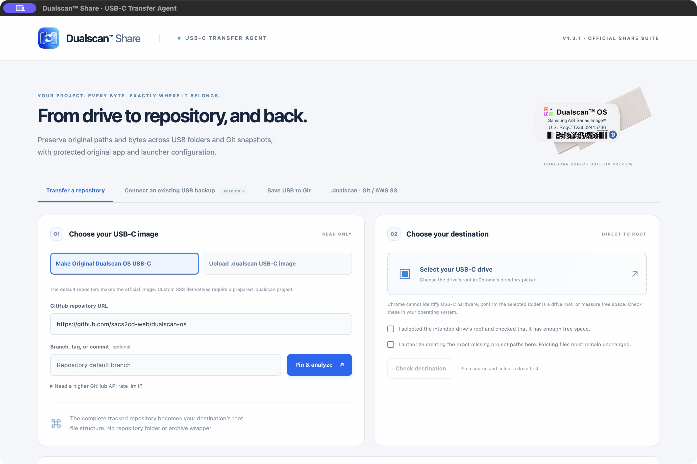

# Dualscan™ Share Suite

Official downloads for macOS, Windows and Chrome.

[Product page and app preview](https://dualscan.cloud/share/) · [Privacy](https://dualscan.cloud/share/privacy.html)

**[Read the detailed Instruction Manual](INSTRUCTION-MANUAL.md)** — installation, .dualscan creation, USB transfers, Git/AWS backups, restore and troubleshooting. [Create a .dualscan file](INSTRUCTION-MANUAL.md#create-dualscan) · [Website edition](https://dualscan.cloud/share/manual.html)

## Downloads · 1.3.2

| Platform | Download |
| --- | --- |
| macOS · Apple silicon | [ARM64 app ZIP](https://github.com/sacs2cd-web/dualscan-os-share-suite/releases/download/v1.3.2/Dualscan-Share-1.3.2-mac-arm64.zip) |
| macOS · Intel | [x64 app ZIP](https://github.com/sacs2cd-web/dualscan-os-share-suite/releases/download/v1.3.2/Dualscan-Share-1.3.2-mac-x64.zip) |
| Windows · 64-bit | [Portable EXE](https://github.com/sacs2cd-web/dualscan-os-share-suite/releases/download/v1.3.2/Dualscan-Share-1.3.2-win-x64.exe) |
| Chrome | [Manifest V3 plugin ZIP](https://github.com/sacs2cd-web/dualscan-os-share-suite/releases/download/v1.3.2/dualscan-share-1.3.2.zip) |

[SHA-256 checksums](https://github.com/sacs2cd-web/dualscan-os-share-suite/releases/download/v1.3.2/SHA256SUMS.txt)

## Dualscan™ Share Pro for Android · 1.0.10

[Download the Android APK](https://github.com/sacs2cd-web/dualscan-os-share-suite/releases/download/share-pro-v1.0.10/Dualscan-Share-Pro-1.0.10-android.apk) · [SHA-256 checksums](https://github.com/sacs2cd-web/dualscan-os-share-suite/releases/download/share-pro-v1.0.10/SHA256SUMS.txt) · [Release and installation notes](https://github.com/sacs2cd-web/dualscan-os-share-suite/releases/tag/share-pro-v1.0.10) · [Pro product page](https://dualscan.cloud/share/pro/)

APK size: 46,105,471 bytes · SHA-256: `ca90a08f06d98688fcdf222f49527f00c43bcb788e697a6530fdb4813a85094b`

Android 11 or newer. The main-panel **Scan a Dualscan™ Code** button opens the bundled QR/Data Matrix scanner, with continuous autofocus where supported and tap focus/metering. Camera permission is requested only when scanning; endpoint paste and local project files remain available. Supported USB storage and a system document/folder picker are required for authoring and restoration; TV support depends on the device.

Install the APK over the existing official Pro app. Do not uninstall or clear app data: the wallet and purchase journal are stored locally, with no recovery phrase export. Verify the download against `SHA256SUMS.txt` before installation.

**Platform Tools are released As-Is and Project Manager testing should be done before any and all commercial releases.** Physical S24 camera, supported USB/Samsung restore, funded payment and live Android Git/S3 transfer acceptance remain required before commercial use.

This repository contains download guidance and the distribution license. GitHub's automatically generated ZIP/TAR archives contain that documentation.

## Chrome installation

Use desktop Chrome 132 or newer with File System Access support. Extract the plugin ZIP, open `chrome://extensions`, enable Developer mode, choose **Load unpacked**, and select the extracted folder containing `manifest.json`. Click the Dualscan™ Share toolbar icon. The ZIP contains the files required to run the extension.

## Desktop installation and trust

Extract the Mac ZIP and open the app for your architecture. Run the Windows x64 portable EXE on Windows. Mac apps use ad-hoc signatures without Developer ID or notarization; Windows is unsigned. Windows execution, live AWS/Git-provider publication, physical USB and Samsung restoration acceptance remain untested.

## Original image preservation

SSS derivative saves require every original file and app to match the pinned official reference. Original snapshots remain logically first. Added snapshots use separate validated folders beneath `SmartSwitchBackup2`. Physical folder order and decoded home/tray coordinates are not certified.

Support: [sa.cs2cd@gmail.com](mailto:sa.cs2cd@gmail.com).

## USB and cloud projects

Card 01 offers **Make Original Dualscan OS USB-C** or **Upload .dualscan USB-C image**. Verified derivative restores place SmartSwitchBackup2 and the other original package files directly at the USB root. Git/AWS artwork is checked before display.

New AWS publications use a random Dualscan OS folder ID matching the project file ID. All files must pass anonymous read-back; configure the exact-folder public policy before publishing. Protect personal SSS additions using Smart Switch encryption first.

New project files use binary Typelocker app protection. The common app key is recoverable from the app; add a user passphrase for confidential metadata. Public cloud payloads remain public independently of manifest protection.

## GitHub connectivity · 1.3.2

The desktop apps now send the User-Agent required by GitHub, fixing a 403 that occurred even with a valid access token. All builds provide clearer GitHub error details, quota/reset timing and safe retry handling. Reopen the updated app and retry Pin & analyze. A session token can raise API limits; it is not needed to correct the missing-header bug.
